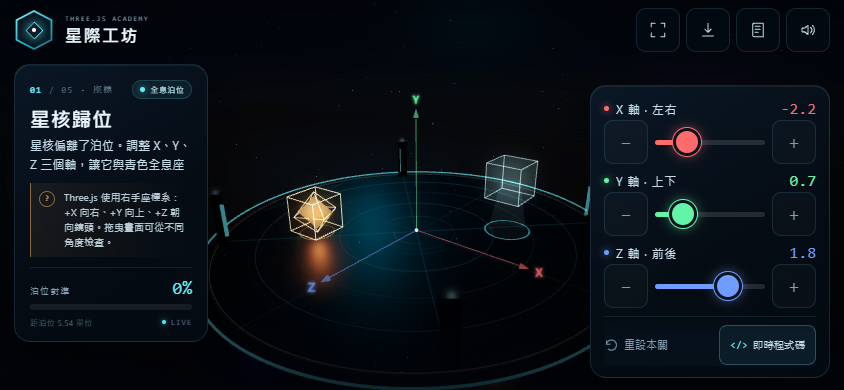
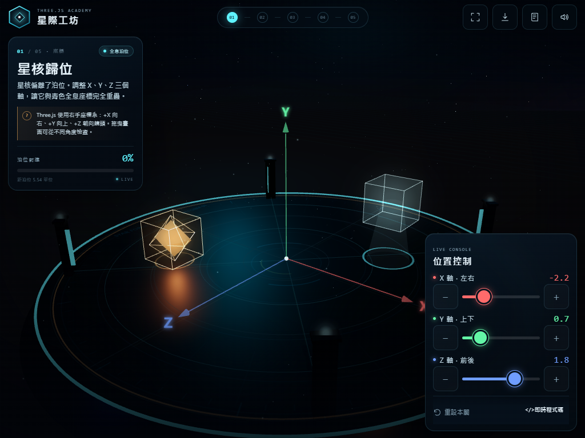

# 星際工坊 · Three.js 互動學院

一個以 **手機／iPad 橫向遊玩** 為優先的 Three.js 教育遊戲。玩家修復漂浮天文台的五件展品，依序學會 **座標、旋轉、縮放、燈光與動畫**。

▶ **[線上遊玩](https://mkpcai2.github.io/starforge-academy/)** · [GitHub 原始碼](https://github.com/mkpcai2/starforge-academy)



## 線上版

遊戲已部署到 GitHub Pages，支援 PWA 安裝、全螢幕與離線快取：

**<https://mkpcai2.github.io/starforge-academy/>**

每次推送到 `main` 分支，GitHub Pages 會自動重新建置。

## 手機／iPad 安裝

1. 用手機或 iPad 的 Safari／Chrome 開啟上面的網址。
2. 把裝置轉成 **橫向**；遊戲只支援橫向，直向時會顯示旋轉提示。
3. 點右上角的 **「安裝」**，或使用瀏覽器分享選單的「加入主畫面」。
4. 之後從主畫面啟動，就會以獨立 App 視窗、全螢幕方式遊玩，離線也能載入。

- iPhone／iPad Safari：分享 → **加入主畫面**
- Android Chrome：選單 → **安裝應用程式**
- 已安裝 PWA 後，遊戲會自動隱藏安裝按鈕

> 這是「PWA 優先」版本，日後可以用 Capacitor 包成 iOS/iPadOS App；目前尚未包含 Xcode 專案與 App Store 上架設定。

## 橫向遊玩

- 手機：左側任務卡、右側觸控控制台，3D 場景在中間。
- iPad：同樣的雙側駕駛艙配置，使用更大的場景與觸控目標。
- 直向：顯示「請轉為橫向」遮罩，避免把橫向遊戲硬塞進窄版。
- 桌面版仍保留原本的完整介面。

### 全螢幕

- 點右上角的**四角圖示**可進入／離開全螢幕（支援 Fullscreen API 的瀏覽器）。
- Safari 分頁的網址列與分頁列會佔用高度，網頁本身無法移除；若全螢幕 API 不可用，請用 **分享 → 加入主畫面**，從主畫面啟動就是真正的全螢幕 App 視窗。
- 已加入短視窗自適應：即使 Safari 工具列還在，任務卡、三個滑桿與底部按鈕也會完整顯示，不再被裁切。



## 五個關卡

| 關卡 | 主題 | 學到的 API |
| --- | --- | --- |
| 01 星核歸位 | 位置 | `position.set(x, y, z)` |
| 02 星盤定向 | 旋轉 | `rotation.x / rotation.y`、`degToRad()` |
| 03 水晶校準 | 縮放 | `scale.set(x, y, z)` |
| 04 三光調和 | 燈光 | `light.color`、`light.intensity` |
| 05 軌道同步 | 動畫 | `Clock`、`Math.cos / sin`、`requestAnimationFrame` |

每一關都有即時程式碼面板，會跟著滑桿同步更新；右上角「學習筆記」整理了五個概念與延伸說明。完成五關後，天文台會重新啟動，並可自由環視。

## 操作

- 拖曳 3D 場景：環視
- 雙指／滾輪：遠近縮放
- 大型滑桿與 `+` / `−`：調整數值
- 右上角四角圖示：全螢幕
- 程式碼按鈕：全螢幕程式碼面板
- 完成關卡後：閱讀概念說明，前往下一關
- 支援震動回饋（Android 等支援 Vibration API 的裝置）

## 本機啟動

```powershell
git clone https://github.com/mkpcai2/starforge-academy.git
cd starforge-academy
node serve.mjs
```

然後開啟 <http://127.0.0.1:8137>。也可以雙擊 `start.bat`（Windows），或改用任何靜態伺服器：

```powershell
python -m http.server 8137
```

> 由於使用 ES Module 載入 Three.js，請透過本機伺服器開啟，不要直接雙擊 `index.html`。Service Worker 只在 HTTPS 下註冊，因此本機 http 版本不會有離線快取。

## 技術

- Three.js r170（本地 `vendor/`，無需連網）
- 原生 ES Modules，無打包工具
- PWA：manifest、192／512 圖示、Service Worker、離線 shell
- 觸控優先 HUD：44px 觸控目標、安全區、橫向鎖定提示
- 短視窗自適應與 Fullscreen API
- WebGL 即時陰影、PMREM 環境反射、程序化星空與平台材質
- Web Audio API 即時合成音效
- 繁體中文、手機／iPad／桌面自適應

## 專案結構

```text
starforge-academy/
├─ index.html
├─ style.css
├─ manifest.webmanifest
├─ sw.js
├─ serve.mjs
├─ start.bat
├─ preview.png
├─ preview-intro.png
├─ preview-mobile.png
├─ preview-ipad.png
├─ icons/
│  ├─ icon-192.png
│  ├─ icon-512.png
│  └─ apple-touch-icon.png
├─ src/
│  ├─ main.js      遊戲流程、UI、相機、特效、PWA 安裝
│  ├─ levels.js    五個關卡的 3D 內容與判定
│  ├─ world.js     場景、燈光、平台、星空、片頭與結局
│  └─ utils.js     共用材質、動畫工具、音效
└─ vendor/
   ├─ three.module.js
   └─ OrbitControls.js
```

## 教學延伸

- 在瀏覽器 console 使用 `__STARFORGE__.goToLevel(3)` 可直接跳到指定關卡。
- `__STARFORGE__.setValues({ r: 1.75, g: 0.6, b: 1.15 })` 可以觀察即時程式碼與 3D 畫面的同步。
- 想改成其他題目，修改 `src/levels.js` 裡的 `LEVELS` 資料與 `successValues` 即可。

## 備註

- 建議使用 iOS 16.4+／iPadOS 16.4+ 的 Safari，或近期版本的 Chrome／Edge。
- 遊戲不需要任何外部圖片或音效檔；所有視覺與聲音都在執行時生成。
- 若 `start.bat` 的伺服器視窗顯示連接埠被占用，代表服務已在執行，直接開 <http://127.0.0.1:8137> 即可。
