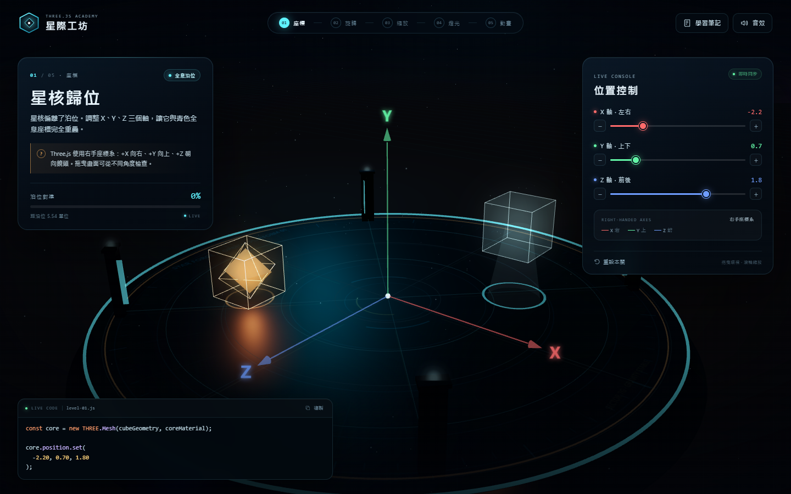

# 星際工坊 · Three.js 互動學院

一個可以直接在瀏覽器玩的 Three.js 教育遊戲。玩家修復漂浮天文台的五件展品，依序學會 **座標、旋轉、縮放、燈光與動畫**。



## 啟動

```powershell
cd threejs-academy
node serve.mjs
```

然後開啟 <http://127.0.0.1:8137>。也可以雙擊 `start.bat`（Windows），或改用任何靜態伺服器：

```powershell
python -m http.server 8137
```

> 由於使用 ES Module 載入 Three.js，請透過本機伺服器開啟，不要直接雙擊 `index.html`。

## 五個關卡

| 關卡 | 主題 | 學到的 API |
| --- | --- | --- |
| 01 星核歸位 | 位置 | `position.set(x, y, z)` |
| 02 星盤定向 | 旋轉 | `rotation.x / rotation.y`、`degToRad()` |
| 03 水晶校準 | 縮放 | `scale.set(x, y, z)` |
| 04 三光調和 | 燈光 | `light.color`、`light.intensity` |
| 05 軌道同步 | 動畫 | `Clock`、`Math.cos / sin`、`requestAnimationFrame` |

每一關都有即時程式碼面板，會跟著滑桿同步更新；右上角「學習筆記」整理了五個概念與延伸說明。完成五關後，天文台會重新啟動，並可自由環視。

## 操作

- 拖曳畫面：環視 3D 場景
- 滾輪／雙指：遠近縮放
- 右側滑桿：調整數值
- `+` / `−` 按鈕：微調一個步進
- 完成關卡後：閱讀概念說明，前往下一關
- 手機版：控制台位於底部，程式碼按鈕在控制台右下角

## 技術

- Three.js r170（本地 `vendor/`，無需連網）
- 原生 ES Modules，無打包工具
- WebGL 即時陰影、PMREM 環境反射、程序化星空與平台材質
- Web Audio API 即時合成音效
- 繁體中文、桌面與手機響應式介面

## 專案結構

```text
threejs-academy/
├─ index.html
├─ style.css
├─ serve.mjs
├─ start.bat
├─ preview.png
├─ preview-intro.png
├─ src/
│  ├─ main.js      遊戲流程、UI、相機、特效
│  ├─ levels.js    五個關卡的 3D 內容與判定
│  ├─ world.js     場景、燈光、平台、星空、片頭與結局
│  └─ utils.js     共用材質、動畫工具、音效
└─ vendor/
   ├─ three.module.js
   └─ OrbitControls.js
```

## 教學延伸

- 在瀏覽器 console 使用 `__STARFORGE__.goToLevel(3)` 可直接跳到指定關卡。
- `__STARFORGE__.setValues({ r: 1.75, g: 0.6, b: 1.15 })` 可以觀察即時程式碼與 3D 畫面的同步。
- 想改成其他題目，修改 `src/levels.js` 裡的 `LEVELS` 資料與 `successValues` 即可。

## 備註

- 建議使用 Chrome、Edge 或 Safari 的近期版本，並開啟硬體加速。
- 遊戲不需要任何外部圖片或音效檔；所有視覺與聲音都在執行時生成。
- 若 `start.bat` 的伺服器視窗顯示連接埠被占用，代表服務已在執行，直接開 <http://127.0.0.1:8137> 即可。
